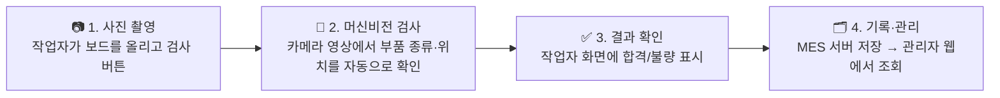
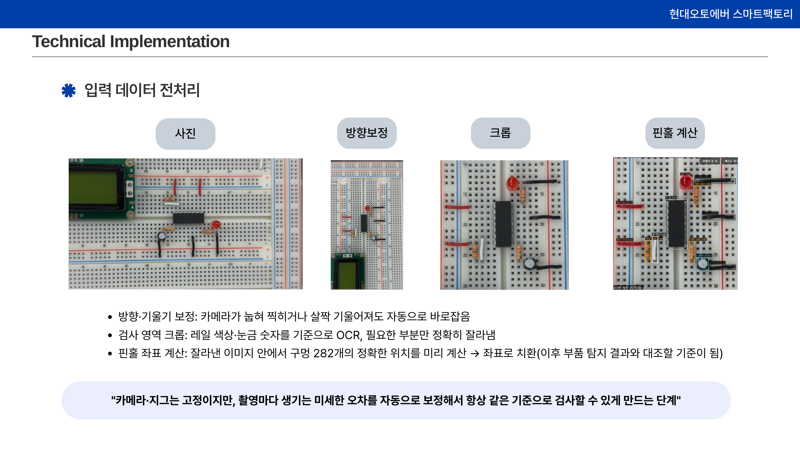
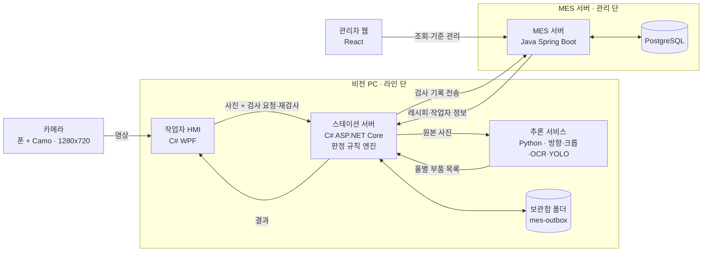
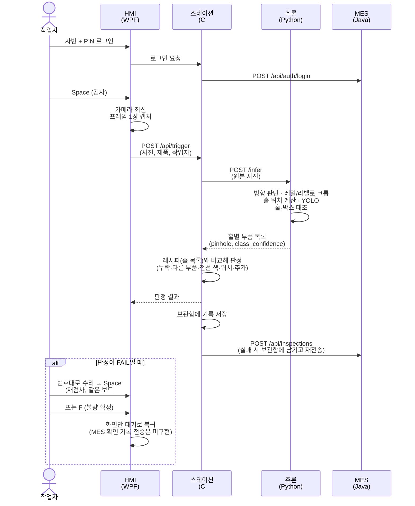
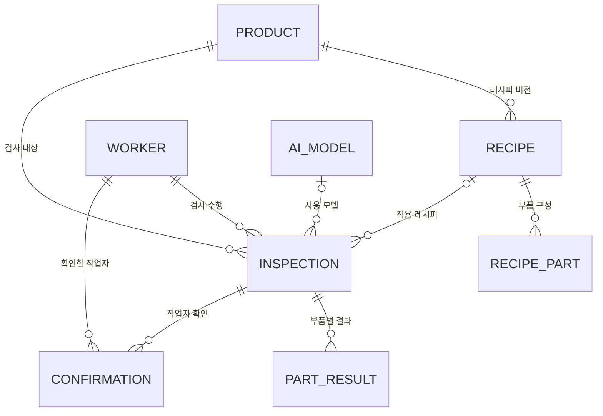
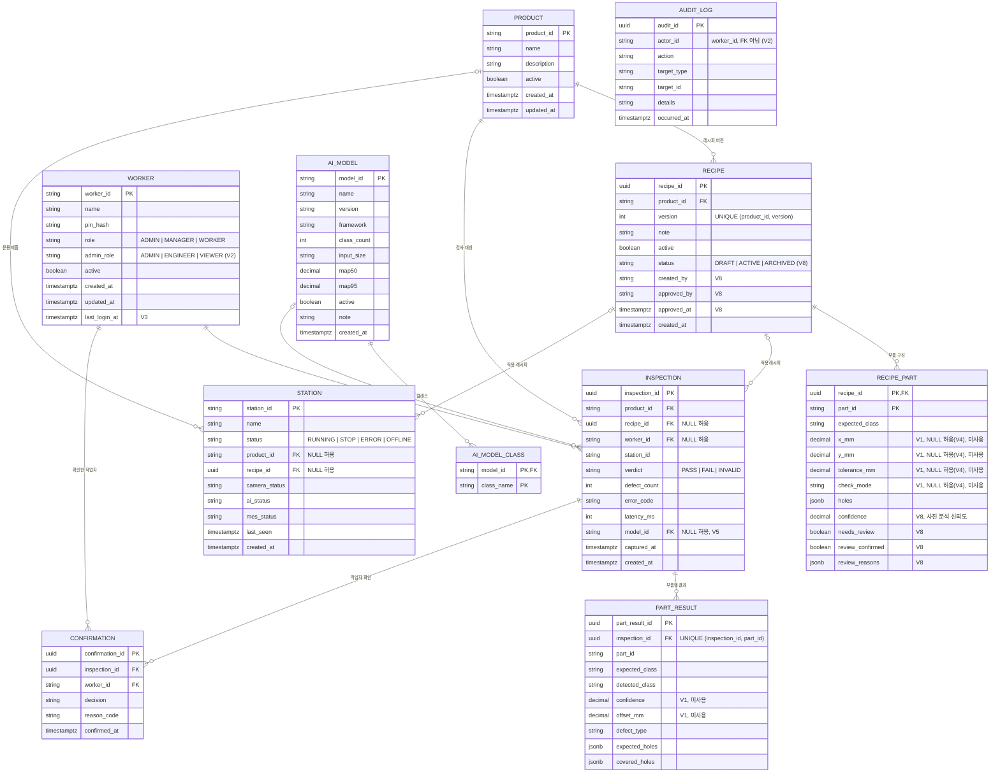

# PCB AOI 검사 스테이션

브레드보드 PCB의 부품 오장착(누락·위치·오부품·전선 색)을 카메라로 검사하고, 결과를 MES에 기록하는 시스템.

## 한눈에 보기



- **작업자**는 HMI(검사 화면)에서 사번으로 로그인하고, 보드를 찍으면 결과(합격/불량)를 바로 확인한다. 불량이면 수리 후 재검사하거나 불량으로 확정한다.
- **관리자**는 웹 대시보드에서 검사 이력·불량 통계·검사 기준(레시피)·사용자 계정을 관리한다.
- 자세한 내부 동작은 아래 "시스템 구성도"와 "검사 흐름"에서 다룬다. 처음 본다면 이 두 다이어그램만 읽어도 전체 그림이 잡힌다.

## 프로젝트 정보와 내 담당

> 카메라 사진 한 장에서 부품이 꽂힌 핀홀 위치를 찾아내는 **머신비전 추론 서비스**를 맡았습니다. 5명이 만든 교육용 PoC이며, 저는 사진을 받아 `{핀홀, 부품 종류, 신뢰도}` 목록으로 바꿔 돌려주는 부분(`inference/`)을 담당했습니다.

| 항목 | 내용 |
|---|---|
| 과정 | 현대오토에버 모빌리티 SW 스쿨 4기 스마트팩토리 과정 |
| 시기 | 2026.09 (9/29 발표) |
| 팀 | 5명 |
| 성격 | 교육용 PoC. 검사 대상은 NE555 브레드보드 회로 1종이며, 산업용 AOI 장비나 양산 라인 경험이 아닙니다 |
| 팀 결과 | 요구사항 5개 달성(팀 자체 평가), 보드 1장 검사 평균 0.93초(10회 측정, 기준 5초). 모두 발표자료 기준 |

### 팀 구성

| 역할 | 맡은 부분 |
|---|---|
| **나 (이 저장소 소유자)** | **추론 서비스: 전처리, 핀홀 위치 계산, 부품-핀홀 매칭, `/infer` API** |
| 팀장 | 검사 스테이션 서버, 작업자 HMI |
| 팀원 A | RTMDet 모델, MES, 작업자 인증, 관리자 웹 |
| 팀원 B | 학습 데이터 수집, 고전적 영상처리 모델, 발표 자료 |
| 팀원 C | 학습 데이터 수집·전처리·라벨링, YOLO 학습, 최적 모델 선정 |

### 내가 만든 부분: 사진 → 핀홀 목록



1. **방향·기울기 보정과 크롭**: 카메라가 눕거나 기울어도 레일 색상과 행 번호(OCR)로 검사 영역만 잘라냅니다.
2. **핀홀 282개 위치 계산**: 잘라낸 영상에서 각 핀홀의 픽셀 위치를 계산합니다.
3. **부품 탐지 연결**: YOLO가 찾은 부품 박스를 핀홀 라벨(예: `J9`)로 바꿉니다. 부품별 다리 개수 규칙과 중복 박스 제거를 적용했습니다.
4. **결과 전달**: 스테이션(C#)에 `{pinhole, class, confidence}`를 돌려주고, 최종 합격/불량 판정은 스테이션이 합니다.

### 대표 문제 해결: 핀홀이 한 칸씩 밀리는 오류

- **문제**: 열의 마지막 점을 마지막 행으로 보고 행 위치를 계산했는데, 부품이 가리거나 레일 열이 짧은 보드에서는 핀홀이 한 칸씩 밀렸습니다.
- **원인 파악**: 결과를 사진 위에 겹쳐 눈으로 확인하며 가정이 깨지는 경우를 하나씩 찾았고, 다섯 가지 원인을 특정했습니다.
- **해결**: 보드에 인쇄된 "10~30" 숫자 위치를 OCR로 읽어 행 위치의 기준점으로 쓰자고 제안했고, 기준점이 부족하면 이전 방식으로 되돌아가게 했습니다.
- **결과**: 테스트 사진 2장(board4, board5)에서 좌우 모서리 높이 차가 최대 30px대에서 1~2px로 줄었습니다. 별도의 정량 평가(정확도, 오검출률)는 하지 않았습니다.

다섯 가지 원인과 해결 과정은 [inference/WORKLOG.md](inference/WORKLOG.md) 맨 위에 요약했습니다.

### 최종 모델은 YOLOv8n (팀 선정, 저는 연동과 확인)

모델 학습·비교·선정은 팀원 C가 맡았고, 저는 선정된 모델을 추론 서비스에 연결하고 같은 사진으로 모델을 바꿔 가며 결과를 확인했습니다.

- **1차 선정(9/23 발표자료)**: YOLOv8·YOLO26의 n/s/m 6종을 mAP50-95와 처리 속도로 비교해 YOLO26m을 골랐습니다. 이 모델의 혼동행렬에서는 실제 470Ω 저항이 330Ω으로 분류되는 비율이 0.80이었습니다.
- **2차 재검증(최종 발표자료)**: 실제 검사 사진 8장에서 오류 없이 분류한 YOLOv8n으로 바꿨습니다. 시연에서도 YOLOv8n을 썼고, YOLO26m은 실시간 환경에서 부품을 잘 읽지 못했습니다.
- **제 쪽 확인(작업 로그, 9/28)**: 사진 3장에 YOLOv8n·v9m·26m·12m 가중치를 바꿔 넣어 눈으로 비교했습니다. YOLOv8n만 분류 오류가 없었고, 나머지는 저항 330Ω/470Ω 혼동이나 전선을 IC로 오인하는 오류가 있었습니다.
- 한계: 라벨 있는 별도 검증셋 기준의 정량 비교가 아니라 소규모 사진 확인에 근거한 선택입니다.

### 개발 방식과 한계

- 코드는 Claude(AI)와 함께 작성했습니다(커밋의 `Co-Authored-By` 표기). 문제 특정, 실측 확인, 기준 결정은 직접 했습니다.
- 브레드보드 회로 1종, 직접 촬영한 81장의 소규모 데이터, 웹캠 기반 PoC입니다.
- 조명이 바뀔 때 저항 색 구분이 약하고, IC·LED 극성 검사는 구현하지 않았습니다. 시연용 레시피(`NE555-B` v3)는 조명에 따라 470Ω을 오인해 저항 값 판별을 범위에서 제외했습니다(저항 3개 모두 330Ω으로 등록).

<details>
<summary>내가 작성한 코드 위치</summary>

| 단계 | 파일 |
|---|---|
| 방향 판별·크롭 | `inference/app/roi.py`, `rail_detect.py`, `label_detect.py` |
| 핀홀 위치 계산 | `inference/app/board_detect.py`, `pinhole_grid.py` |
| 부품-핀홀 매칭 | `inference/app/board.py`, `main.py` |
| API 계약 | [docs/api-contract.md](docs/api-contract.md) |

아래는 팀장이 작성한 부분입니다 (제 담당이 아닙니다).

| 구분 | 파일 |
|---|---|
| 레시피 초안 API `POST /recipe-draft` | `inference/app/recipe_draft.py`, `main.py`의 해당 라우트 |
| 부품 단위 묶음 매칭 (`/infer` 결과는 그대로) | `inference/app/board.py`의 `match_holes_to_boxes_grouped` |
| 위 기능의 단위 테스트 | `inference/tests/` |

</details>

**목차**
1. [시스템 구성도](#1-시스템-구성도)
2. [검사 흐름](#2-검사-흐름)
3. [저장소 구조](#3-저장소-구조)
4. [모듈별 정보](#4-모듈별-정보)
5. [DB 주요 테이블](#5-db-주요-테이블-mes-소유)
6. [사용자 인증과 관리](#6-사용자-인증과-관리)
7. [작업 규칙](#7-작업-규칙)
8. [실행 방법](#8-실행-방법)

## 1. 시스템 구성도



**원칙**
- 판정은 스테이션(C#) 한 곳에서만 한다. 추론 서비스는 탐지 결과만, MES는 기록과 기준만 담당한다.
- DB에 직접 붙는 것은 MES뿐이다. 나머지는 모두 API로 접근한다.
- MES가 끊겨도 검사는 계속된다. 스테이션이 검사 기록을 보관함 폴더(`mes-outbox`, 기록 한 건 = JSON 파일 하나)에 먼저 저장하고, 백그라운드에서 오래된 것부터 MES로 보낸다.
  - SQLite 대신 파일을 쓰는 이유: 비전 PC의 보안 정책(애플리케이션 제어)이 새 네이티브 DLL을 막은 적이 있고(torch), 폴더만 열면 밀린 기록이 보여 확인이 쉽다.
- 사진은 돌리지 않은 원본 그대로 보낸다. 방향은 추론 서비스가 판단한다 (촬영 기준: 보드 번호 10이 화면 위).

## 2. 검사 흐름



- 판정 불가·오류일 때도 Space로 재검사한다. 같은 보드의 3번째 검사(`Hmi:MaxAttempts` 기본값)에서도 FAIL이면 불량 확정(F)을 권하는 안내가 뜬다.
- MES에는 `POST /api/inspections/{id}/confirmations`(확인 기록)가 만들어져 있지만, 최종본 기준 HMI·스테이션은 아직 이 API를 호출하지 않는다.

**판정 방식 (홀 목록)**
- 보드 좌표는 A~U(보드 번호 10~30, 21행) × 0~13(레일2 + A~E + F~J + 레일2, 14열). 전원 레일에는 E·K·Q 행이 없다.
- 레시피 = 부품마다 "덮어야 할 홀 목록". 정답 보드를 추론에 넣어 나온 결과를 사람이 실제 보드와 대조해 확정한다 (예: `NE555-A`, 샘플은 `docs/recipe-ne555.json`).
- 판정: 홀이 전부 비었으면 누락 → 종류가 다르면 다른 부품/전선 색 → 일부만 덮였으면 위치 → 레시피 밖에 부품이 있으면 추가. 신뢰도 0.5 미만 탐지는 제외.
- mm 좌표 방식(초기 설계)은 쓰지 않는다. mm 컬럼(`x_mm`·`y_mm`·`tolerance_mm`)과 `check_mode`는 V4에서 NULL 허용으로 바꿔 더 이상 채우지 않는다 (컬럼 자체는 남아 있다) (현재 마지막 번호는 V8, 번호는 MES 담당이 정함).

**레시피 등록 (사진 기반 초안)**
- 관리자 웹에서 보드 사진을 올리면 MES가 Python으로 전달해 부품·홀 초안을 받도록 MES 쪽 클라이언트(`RecipeDraftClient`, 기본 경로 `/recipe-draft`)가 구현돼 있고, Python 쪽 `POST /recipe-draft`(`inference/app/recipe_draft.py`)는 팀장이 작성했다. `/infer`와 같은 파이프라인을 돌린 뒤 YOLO 박스 하나를 부품 하나로 묶어 부품별 다리 홀 초안을 만든다. React는 Python을 직접 호출하지 않는다.
- 받은 초안은 사람이 검토·수정한 뒤 새 버전으로 저장한다 (`status=DRAFT`, `active=false`).
- `ADMIN`이 승인하면 `status=ACTIVE`로 바뀌고 해당 제품의 기존 활성 버전은 `status=ARCHIVED`가 된다.
- 자세한 요청·응답 형식은 [API 계약서](docs/api-contract.md)의 "사진 기반 레시피 초안" 참고.

## 3. 저장소 구조

```
pcb-aoi-station/
├── README.md
├── service-config.properties     MES·웹·Python 서비스 주소·포트 설정
├── docs/                         설계 문서
│   ├── api-contract.md           API 계약서
│   ├── recipe-ne555.json         레시피 샘플 (NE555-A)
│   └── images/                   README용 이미지
├── station/                      C# · 팀장
│   ├── Inspection.slnx
│   ├── Inspection.Contracts/     HMI와 스테이션이 공유하는 데이터 모델
│   ├── Inspection.Hmi/           작업자 화면 (WPF)
│   ├── Inspection.Station/       스테이션 서버 (ASP.NET Core)
│   └── Inspection.Tests/         스테이션 단위 테스트
├── inference/                    Python · 비전 담당
│   ├── app/                      FastAPI 추론 서비스
│   ├── tests/                    /recipe-draft 단위 테스트
│   ├── WORKLOG.md                작업 로그 (맨 위에 시행착오 요약)
│   ├── training/                 학습 스크립트
│   └── requirements.txt
├── mes/
│   ├── pcb_manage/                Java · 백엔드 담당
│   │   ├── src/main/java/...      Spring Boot
│   │   ├── src/main/resources/db/ DB 마이그레이션 SQL (V1~V8)
│   │   └── build.gradle.kts
│   └── postman/                   Postman 워크스페이스 전역 변수 설정 (API 컬렉션은 없음)
└── web/                          React · 관리자 웹
    └── src/pages/                대시보드·검사·불량·제품·레시피·레시피 초안·스테이션·AI 모델·사용자·감사 로그
```

모델 가중치 파일과 촬영 데이터셋은 용량이 커서 Git에 올리지 않는다 (`.gitignore`). 공유 드라이브에 두고 경로만 문서에 적는다.

## 4. 모듈별 정보

| 모듈 | 폴더 | 기술 | 포트 | 담당 |
|---|---|---|---|---|
| 작업자 HMI | `station/Inspection.Hmi` | C# WPF (.NET 10) | — | 팀장 |
| 스테이션 서버 | `station/Inspection.Station` | C# ASP.NET Core (.NET 10) | 5215 | 팀장 |
| 추론 서비스 | `inference` | Python, FastAPI, YOLO | 8001 | 최나연 |
| MES 서버 | `mes` | Java, Spring Boot | 8080 | 팀원 A |
| DB | — | PostgreSQL | 5432 | |
| 관리자 웹 | `web` | React | 5173 | 팀원 A |

## 5. DB 주요 테이블 (MES 소유)

현재 스키마: `mes/pcb_manage/src/main/resources/db/migration`의 V1~V8 기준.

### 테이블 관계 요약



<details>
<summary>전체 컬럼이 있는 ER 다이어그램 보기</summary>



</details>

- `inspection_id`는 스테이션이 생성한다. 같은 ID가 재전송되면 MES는 중복 저장하지 않는다 (409). 요청 형식은 `docs/api-contract.md`의 "검사 기록 API".
- 확인 기록은 덮어쓰지 않고 추가만 한다 (감사 추적).
- MES는 이미지와 이미지 경로를 전달받거나 저장하지 않는다.
- V4에서 `inspection.image_path` 컬럼을 제거했다.
- 레시피는 제품별로 버전을 두고(`RECIPE`), 부품 구성은 버전에 붙는다(`RECIPE_PART`).
- 관리자 웹의 스테이션 현황판은 `STATION` 테이블로 관리한다. 현재 시연 환경은 실제 스테이션 한 대(`ST-01`)만 운용한다 (V6).
- AI 모델 이력과 지원 클래스는 `AI_MODEL`·`AI_MODEL_CLASS`에 두고, 검사에 사용한 모델은 `inspection.model_id`로 남긴다 (V5).
- 레시피는 사진 기반 초안(`status=DRAFT`) → 사람 검토 → 승인(`status=ACTIVE`, 기존 활성 버전은 `ARCHIVED`) 흐름을 가진다. 검토가 필요한 부품은 `recipe_part.needs_review`·`review_reasons`로 표시한다 (V8).

**V4 적용 사항** — 검사 기록 API와 핀홀 레시피를 위해 적용했다. 자세한 내용은 `docs/api-contract.md` 검사 기록 API 3번.

| 테이블 | 변경 사항 |
|---|---|
| `inspection` | `verdict`에 `INVALID` 추가, `error_code`·`station_id` 추가, `worker_id` NULL 허용 (로그인 없이 검사한 경우) |
| `part_result` | `expected_class` 추가, `expected_holes`·`covered_holes` 추가 (`confidence`·`offset_mm`는 V1 컬럼 그대로 남아 있음) |
| `recipe_part` | `holes` 추가, mm 컬럼(`x_mm`·`y_mm`·`tolerance_mm`)과 `check_mode`를 NULL 허용으로 변경 (삭제 아님) |
| `recipe` | `note` 추가 |

**V5~V8 적용 사항** — 관리자 웹 대시보드(스테이션 현황·AI 모델)와 사진 기반 레시피 초안을 위해 적용했다. 자세한 내용은 `docs/api-contract.md` "사진 기반 레시피 초안".

| 버전 | 변경 사항 |
|---|---|
| V5 | `STATION`·`AI_MODEL`·`AI_MODEL_CLASS` 테이블 추가, `inspection.model_id` 추가, 대시보드용 제품·레시피·스테이션·모델·검사 시드 데이터 삽입 |
| V6 | 시연용 다중 스테이션 시드를 정리하고 실제 스테이션 한 대(`ST-01`)로 통합 |
| V7 | 이전 표기(`STATION-01`)로 저장된 검사 기록의 `station_id`를 `ST-01`로 통일 |
| V8 | `recipe`에 `status`·`created_by`·`approved_by`·`approved_at` 추가, `recipe_part`에 `confidence`·`needs_review`·`review_confirmed`·`review_reasons` 추가 (레시피 초안 검토·승인 워크플로우) |

- 홀 목록(레시피 홀, 탐지 홀)은 배열 형태(예: `["E9","H9"]`), JSONB 배열로 저장한다.

## 6. 사용자 인증과 관리

- 사번과 PIN으로 로그인하며 PIN은 BCrypt 해시로만 저장한다.
- 로그인 성공 시 1시간 유효한 HS256 JWT를 발급하고 최근 로그인 시각을 기록한다.
- 관리자 웹 Role은 `ADMIN`, `ENGINEER`, `VIEWER`로 구분한다.
- 사용자 조회·추가·수정·활성화·비활성화·PIN 초기화와 감사 로그 조회는 `ADMIN`만 가능하다.
- 계정이 비활성화되거나 Role이 변경되면 기존 JWT도 다음 요청부터 거부한다.
- 현재 로그인한 관리자와 마지막 활성 관리자는 관리자 권한 해제 또는 비활성화가 불가능하다.
- 로그인과 사용자 변경 이력은 `audit_log`에 기록하며 PIN 원문은 남기지 않는다.

세부 요청·응답 형식은 [API 계약서](docs/api-contract.md)를 참고한다.

## 7. 작업 규칙

**브랜치**
- `main`: 항상 실행 가능한 상태. 직접 푸시 금지.
- 작업 브랜치: `모듈/작업내용` (예: `station/hmi-layout`, `mes/inspection-api`, `inference/yolo-train`)
- 작업이 끝나면 PR을 올리고 한 명 이상 확인 후 병합한다.

**충돌 줄이기**
- 각자 자기 폴더 안에서만 작업한다.
- API나 데이터 모양을 바꿀 때는 `docs/api-contract.md`를 먼저 고치고 팀에 알린다.

**커밋 메시지**
- `[station] MVP-7 검사 결과 화면 추가`, `[mes] MVP-25 검사 기록 저장 API` 처럼 모듈과 Jira 키를 앞에 붙인다 (Jira에 커밋이 자동 연결됨).

## 8. 실행 방법

### 빠른 실행 (MES 관리자 웹)

필수 프로그램은 **PostgreSQL, Java 17 이상, Node.js**다. 저장소를 받은 뒤 다음 순서로 실행한다.

1. PostgreSQL에 `pcb_aoi` 데이터베이스를 만든다. 테이블과 초기 데이터는 MES 최초 실행 시 Flyway가 자동으로 생성한다.

```powershell
psql -U postgres -c "CREATE DATABASE pcb_aoi;"
```

2. 첫 번째 PowerShell에서 MES를 실행한다. `<DB 비밀번호>` 부분에는 본인 PostgreSQL 비밀번호를 입력한다 (`DB_PASSWORD`를 설정하지 않으면 기본값 `postgres`로 접속을 시도한다).

```powershell
cd mes\pcb_manage
$env:DB_PASSWORD = "<DB 비밀번호>"
.\gradlew.bat bootRun
```

3. 두 번째 PowerShell에서 관리자 웹을 실행한다. `npm install`은 최초 한 번만 실행하면 된다.

```powershell
cd web
npm install
npm run dev
```

4. 브라우저에서 접속한다.

- 같은 PC: `http://localhost:5173`
- 같은 네트워크의 다른 PC: `http://<MES PC IP>:5173`
- MES API 확인: `http://<MES PC IP>:8080`

포트와 서비스 주소는 루트의 `service-config.properties`에서 관리한다. 다른 PC에서 접속할 때는 `web.public-host`를 MES PC의 실제 IP로 설정하고 MES와 웹을 다시 시작한다. 웹은 브라우저에서 접속한 호스트의 `8080` 포트로 MES API를 호출한다.

사진 기반 레시피 분석까지 사용하려면 Python `/recipe-draft` 서비스가 별도로 실행 중이어야 한다. 해당 서버의 IP와 포트는 `service-config.properties`의 `python.host`, `python.port`에서 설정한다. Python 서비스가 없어도 로그인, 대시보드, 검사 이력 등 일반 MES 기능은 사용할 수 있다.

### MES 서버

Java 17 이상과 PostgreSQL이 필요하다. 기본 접속 정보는 `mes/pcb_manage/src/main/resources/application.properties`에 있으며 운영 환경에서는 `DB_URL`, `DB_USERNAME`, `DB_PASSWORD`, `JWT_SECRET`을 설정한다.

```powershell
cd mes/pcb_manage
.\gradlew.bat bootRun
```

테스트:

```powershell
cd mes/pcb_manage
.\gradlew.bat test
```

### 관리자 웹

Node.js 설치 후 실행한다. 별도 `VITE_API_BASE_URL`을 지정하지 않으면 현재 웹에 접속한 호스트의 `8080` 포트를 MES API로 사용한다.

```powershell
cd web
npm install
npm run dev
```

프로덕션 빌드:

```powershell
cd web
npm run build
```

### 검사 스테이션 (추론·스테이션·HMI)

켜는 순서: **추론 → 스테이션 → HMI** (MES는 따로. 꺼져 있어도 검사는 된다)

**추론 서비스 (8001)** — PowerShell
```powershell
cd <저장소>
Set-ExecutionPolicy -Scope Process -ExecutionPolicy RemoteSigned
.\.venv\Scripts\Activate.ps1
$env:Path += ";C:\Program Files\Tesseract-OCR"
cd inference\app
uvicorn main:app --port 8001
```
- torch는 CPU용이어야 한다 (`pip show torch` → `+cpu`). GPU용은 보안 정책에 막힌다.
- 서버를 켠 뒤 첫 검사는 모델 로딩 때문에 6~7초. 시연 전에 한 번 돌려 둔다.

**스테이션 (5215)**
```powershell
cd station\Inspection.Station
dotnet run
```
- MES 전송은 `appsettings.json`의 `Mes:Enabled`(기본값 `false`)를 `true`로 바꿔야 켜지고, 주소는 `Mes:BaseUrl`.

**HMI**
```powershell
cd station\Inspection.Hmi
dotnet run
```
- 카메라 번호는 [카메라 전환]으로 찾아 `appsettings.json`의 `Camera:Index`에 기록. 카메라가 없으면 [사진 열기].
- Visual Studio와 dotnet run을 동시에 쓰지 않는다 (실행 중인 프로그램이 파일을 잠가 빌드 실패).

**MES (8080)** — PostgreSQL에 `pcb_aoi` DB 생성 후
```powershell
cd mes\pcb_manage
.\gradlew.bat bootRun
```

**촬영 기준**
- 폰은 탑뷰 스탠드에 고정, 보드 번호 10이 화면 위. 검사 영역(번호 10~30 × 양쪽 레일)이 HMI의 노란 점선을 꽉 채우게.
- Camo 좌우 반전 끄기, 초점·노출 잠금. 연결은 USB 또는 폰 핫스팟.
